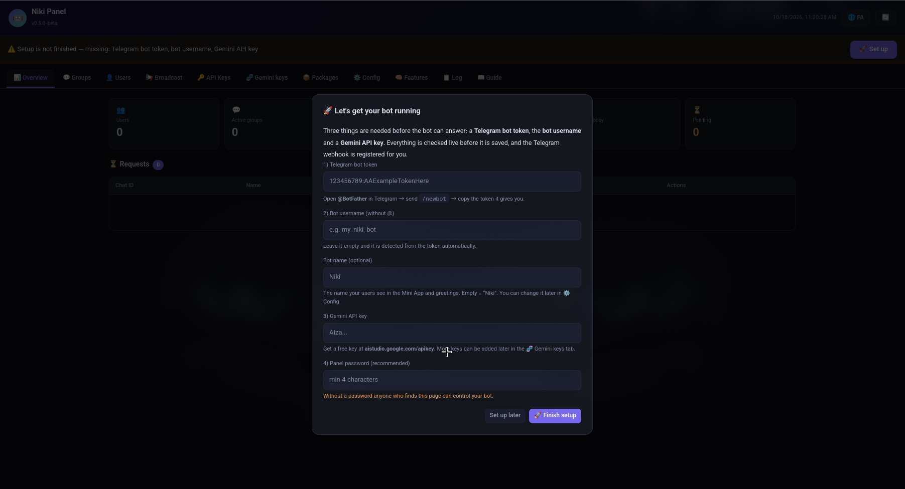
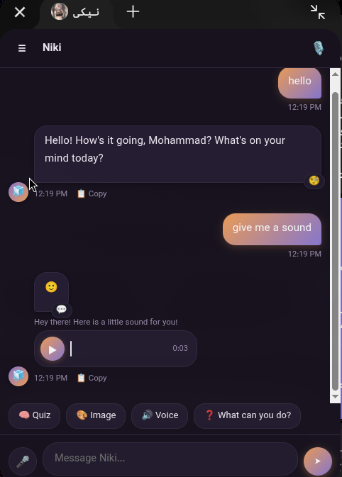
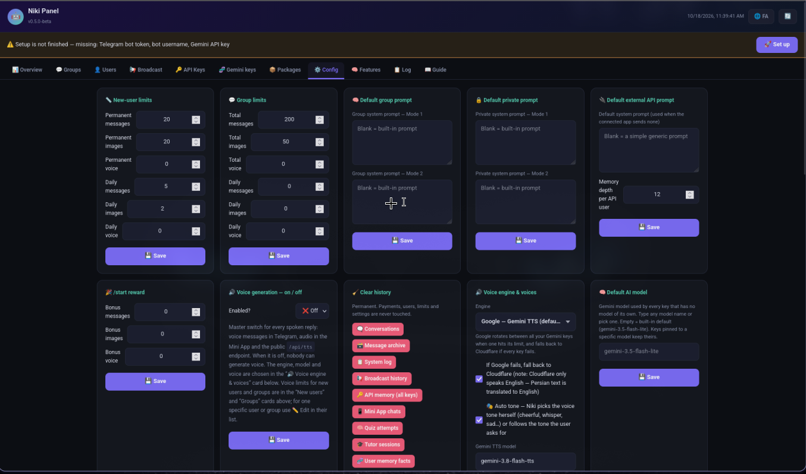

<div align="center">

# 🤖 Niki — AI Assistant for Telegram

**An English-first, multilingual AI assistant for Telegram, powered by Google Gemini and running entirely on Cloudflare Workers.**
Chat · images · voice · quizzes · language tutoring · Mini App · admin panel · public API — in a single file, on the free tier.


**🌐 Language: English · [فارسی](docs/README.md)**

[**🚀 One-click install**](https://wizard.nikibot.workers.dev/) · [Manual install](#-manual-installation) · [Commands](#-bot-commands) · [Admin panel](#-admin-panel) · [Mini App](#-telegram-mini-app) · [API](#-external-api)

</div>

  <p align="center">  </p>


---

## 📑 Table of contents

1. [What is Niki?](#-what-is-niki)
2. [Features](#-features)
   - [Language support](#-language-support)
3. [Requirements](#-requirements)
4. [Installation — the easy way (recommended)](#-installation--the-easy-way-recommended)
5. [Manual installation](#-manual-installation)
6. [First-time setup](#-first-time-setup)
7. [How it works](#-how-it-works)
8. [Bot commands](#-bot-commands)
9. [Admin panel](#-admin-panel)
10. [Telegram Mini App](#-telegram-mini-app)
11. [External API](#-external-api)
12. [Configuration reference](#-configuration-reference)
13. [Privacy & security](#-privacy--security)
14. [Updating](#-updating)
15. [Troubleshooting](#-troubleshooting)
16. [FAQ](#-faq)
17. [Contributing & license](#-contributing--license)

---

## ✨ What is Niki?

Niki is a friendly AI companion for Telegram. Talk to her in a private chat or add her to a group; she replies in **whatever language you write in** (English by default), remembers context, understands photos and voice messages, draws pictures, speaks, teaches English and other languages as well as programming, and hosts quizzes.

Everything ships in **English by default** — the bot's messages, the admin panel, the Mini App and the installer. A complete **Persian (فارسی)** translation is built in as a one-click alternative; see [Language support](#-language-support). 📖 **[خواندن این مستندات به فارسی ← README.fa.md](README.fa.md)**

Everything — the webhook, the admin dashboard, the Mini App front-end, the public API and the data layer — lives in **one JavaScript file** that you deploy to your **own Cloudflare account**. There is no server to maintain and nothing to pay for on the free tier of a small deployment.

---

## 🧩 Features

### 💬 Conversation
- **Gemini-powered chat** with automatic rotation across up to 10 API keys to spread quota.
- **Five personas** (`/mode 1–5`): Normal, Analytical, Custom prompt, English tutor, Programming.
- **Short-term memory** per chat, plus **long-term memory** (searchable archive and durable per-user facts the bot can save).
- **Live web search** (Google Search grounding): say *"search …"* or ask for the latest news, weather, prices or scores. On by default with daily limits per user and group; switch it on/off globally (*Config → Global features*) or per chat (*Features → Per-chat features*). Importance scoring is configurable per chat too.
- Understands **images, voice messages and replies** to earlier messages.
- Natural **emoji reactions** and group-aware behaviour (replies when called by name, or to everything with `/alwayson`).

### 🎨 Media
- **Image generation** (Flux-1-schnell through Workers AI), up to 4 images per request.
- **Voice replies** (text-to-speech) with selectable engine and voices.
- **Speech-to-text** (Whisper on Workers AI) for voice messages.

### 🎓 Learning & fun
- **Language tutor** and **programming tutor** with step-by-step sessions, practice and **spaced-repetition** vocabulary review.
- **Quizzes** you can share with friends, vocabulary cards, stats and leaderboards, certificates.
- **Voice call mode** inside the Mini App.

### 👥 Groups & community
- Group activation flow with admin approval.
- Role hierarchy: **User → Admin → Leader → Super admin**.
- Moderation: mute, ban, purge, pin, lockdown.
- **Invite links** with referral rewards.

### 💳 Monetisation & limits
- Per-user and per-group **daily and total limits** (messages, images, voice).
- **Packages** (time-limited bundles) you can sell with **Telegram Stars** or gift manually.
- Daily caps per chat, maintenance mode, welcome messages.

### 🛠 Administration
- A full **web admin panel** (bilingual FA/EN) with built-in guide: groups, users, broadcasts, API keys, Gemini keys, packages, config, features, logs.
- **Resumable broadcast engine** (queued missions, pause / resume / cancel).
- **Public REST API** (`/api/chat`, `/api/tts`, `/api/stt`) with per-key limits, expiry and CORS control.

### 🔐 Privacy by design
- **No chat viewer, no message search** anywhere in the admin panel or in bot commands.
- Logs contain events, never message text.
- Users can wipe their own memory at any time.

---

## 🌍 Language support

Niki is built for an international audience: **English is the default language everywhere**, and Persian is a fully supported second language.

| Part | Default | Also available |
|---|---|---|
| AI replies | **Auto** — same language the user writes in (English if unclear) | Always English, or always Persian — chosen in Setup or *Config → Reply language* |
| Bot's fixed messages (help, limits, errors) | English | Persian — `/lang fa` |
| Admin panel & built-in guide | English | Persian — 🌐 button |
| Mini App | English | Persian (automatic when the user's Telegram language is Persian) |
| One-click installer | English (`/`) | Persian (`/fa`) |

- Set the default language for the whole bot in the admin panel; each chat can override it with `/lang en` or `/lang fa`.
- The **persona prompts** (how Niki introduces herself and behaves) are plain text under *Admin → Config → Default prompts*. Edit them to give the bot your own name, personality and tone.
- Adding another interface language means translating the dictionaries in the source (`I18N` for bot messages, plus the panel and Mini App strings). Contributions are welcome.

---

## 📋 Requirements

| What | Notes |
|---|---|
| **Cloudflare account** | Free plan is enough to start. |
| **Telegram bot token** | Create a bot with [@BotFather](https://t.me/BotFather). |
| **Gemini API key** | Free key from [aistudio.google.com/apikey](https://aistudio.google.com/apikey). Add more keys later to spread quota. |
| **Your Telegram numeric ID** | Optional, used to become a *super admin*. Get it from any "ID bot", e.g. `@userinfobot`. |
| Node.js 18+ and `wrangler` | Only for the [manual installation](#-manual-installation). |

---

## 🚀 Installation — the easy way (recommended)

The installer deploys Niki to **your own** Cloudflare account in about a minute — no command line needed.

> 🔗 **Installer:** **https://wizard.nikibot.workers.dev/**

### Step by step

1. **Open the installer** — <https://wizard.nikibot.workers.dev/> (English) or <https://wizard.nikibot.workers.dev/fa> (فارسی).
2. **Create a Cloudflare API token.** Click **Create a token** on the installer page. The link pre-selects only the permissions required:
   - Workers Scripts — Edit
   - Workers KV Storage — Edit
   - D1 — Edit
   - Account Settings — Read

   Then press **Continue to summary → Create Token** and **copy the token**.
3. **Paste the token** into the installer, optionally choose a project name, and press **Install**.
4. The installer will, on your account:
   - create a **D1 database** (`NIKI_DB`) and a **KV namespace** (`NIKI_KV`),
   - enable the **Workers AI** binding (`AI`),
   - upload the bot code,
   - enable the `workers.dev` URL,
   - add a **1-minute cron trigger** (used for broadcasts and scheduled jobs).
5. When it finishes you get two links:
   - **Service URL** — `https://<name>.<your-subdomain>.workers.dev`
   - **Admin panel** — `https://<name>.<your-subdomain>.workers.dev/admin` (keep it private!)
6. **You can now delete the API token** in your Cloudflare dashboard — it is no longer needed.
7. Continue with [First-time setup](#-first-time-setup).

> 🔒 **Is my token safe?** The token is used only during the install request to talk to the Cloudflare API. It is not stored and not logged. If you prefer not to trust any third-party page with a token, use the [manual installation](#-manual-installation) instead — it takes ~10 minutes and the result is identical.

> ⚠️ **The panel has no password on first launch.** Open it right after installing and set a password (see below). Until you do, anyone who knows your Worker URL could open the panel.

### Updating with the installer
Run the installer again with the **same project name**. Your D1 database, KV data and secrets are kept; only the code is replaced.

---

## 🧰 Manual installation

Prefer full control, or want to deploy from the command line / CI? Follow these steps.

### 1. Get the code
```bash
git clone https://github.com/YOUR_USERNAME/niki-bot.git
cd niki-bot
npm install -g wrangler        # or: npx wrangler ...
wrangler login
```

### 2. Create the storage
```bash
# D1 database
wrangler d1 create niki-db
# → copy the printed "database_id"

# KV namespace
wrangler kv namespace create NIKI_KV
# → copy the printed "id"
```

### 3. Create `wrangler.toml`
```toml
name = "niki-bot"
main = "bot.js"
compatibility_date = "2025-01-01"

# Workers AI (image generation, speech-to-text)
[ai]
binding = "AI"

[[d1_databases]]
binding = "NIKI_DB"
database_name = "niki-db"
database_id = "PASTE_D1_DATABASE_ID"

[[kv_namespaces]]
binding = "NIKI_KV"
id = "PASTE_KV_NAMESPACE_ID"

# Cron heartbeat — broadcasts, scheduled jobs (runs every minute)
[triggers]
crons = ["* * * * *"]

[vars]
# Comma-separated numeric Telegram IDs of the bot owner(s)
SUPER_ADMIN_IDS = "123456789"
```

> ℹ️ Binding names **must** be exactly `NIKI_DB`, `NIKI_KV` and `AI`.
> The database schema is created automatically on the first request — there is nothing to migrate by hand.

### 4. Add secrets
```bash
wrangler secret put TELEGRAM_BOT_TOKEN        # from @BotFather
wrangler secret put GEMINI_API_KEY_1          # your first Gemini key
# optional: more keys, GEMINI_API_KEY_2 … GEMINI_API_KEY_10
# optional but recommended: webhook protection
wrangler secret put TELEGRAM_WEBHOOK_SECRET   # any long random string
```
> You can also add the bot token and Gemini keys later from the admin panel instead of using secrets (see [First-time setup](#-first-time-setup)).

### 5. Deploy
```bash
wrangler deploy
```
Wrangler prints your Worker URL, e.g. `https://niki-bot.<your-subdomain>.workers.dev`.

### 6. Register the Telegram webhook

**Option A — from the panel (easiest):** open `https://<your-worker-url>/admin`, finish the setup card, and the panel registers the webhook for you.

**Option B — by hand:**
```bash
curl "https://api.telegram.org/bot<TELEGRAM_BOT_TOKEN>/setWebhook" \
  -d "url=https://<your-worker-url>/" \
  -d "secret_token=<TELEGRAM_WEBHOOK_SECRET>" \
  -d 'allowed_updates=["message","edited_message","callback_query","pre_checkout_query"]'
```
(Leave out `secret_token` if you did not set `TELEGRAM_WEBHOOK_SECRET`.)

### 7. Verify
```bash
curl "https://api.telegram.org/bot<TELEGRAM_BOT_TOKEN>/getWebhookInfo"
```
`url` should be your Worker URL and `last_error_message` should be empty. Send `/start` to your bot.

---

## 🧭 First-time setup

Open the **admin panel** at `https://<your-worker-url>/admin`.

1. **Finish the setup bar** at the top (it lists whatever is still missing):
   - 🤖 **Telegram bot token** (the bot username is detected automatically)
   - 🌍 **Bot language** — *Auto* (default), *English* or *Persian*: the language the AI speaks. The system prompt adapts to it. Change it later in *Config → Reply language*.
   - 🧬 **Gemini API key**
   - 🔐 **Panel password** — *set this immediately.*
   The setup card also registers the Telegram webhook for you.
2. **Add yourself as a super admin:** *Config → Super admins* → add your numeric Telegram ID (or use the `SUPER_ADMIN_IDS` variable).
3. **Set limits:** *Config → New-user limits / Group limits* — decide how many messages, images and voice notes users get.
4. *(Optional)* Edit the default **personas/prompts**, **bot name**, welcome texts and voice engine.
5. Open the **📖 Guide** tab — a complete, bilingual manual of every panel section, with your Mini App link ready to copy.
6. **Test it:** message your bot, then add it to a group and run `/init` (see below).

### Activating a group
1. Add the bot to a group.
2. The group owner/creator sends **`/init`**. The request appears under **Overview → Requests** (and super admins are notified in private chat).
3. A super admin presses **Approve**. The bot now answers in that group.

Until a group is approved, the bot only responds to the activation flow.

---

## ⚙️ How it works

```
Telegram ──► Cloudflare Worker (this file) ──► Google Gemini (chat, vision, TTS)
                 │   │   │                └──► Workers AI (Flux images, Whisper STT)
                 │   │   └── KV  (caches, sessions, rate limits, dedup)
                 │   └────── D1  (users, groups, limits, memory, packages, logs)
                 └────────── Cron (every minute: broadcasts & scheduled jobs)
```

- **Webhook** — Telegram POSTs updates to `/`. If `TELEGRAM_WEBHOOK_SECRET` is set the `X-Telegram-Bot-Api-Secret-Token` header is verified, and updates are de-duplicated by `update_id`.
- **Routes**

  | Route | Purpose |
  |---|---|
  | `/` (POST) | Telegram webhook |
  | `/admin` (or `<prefix>/admin`) | Admin panel |
  | `/app` | Telegram Mini App |
  | `/api/chat` · `/api/tts` · `/api/stt` | Public REST API |

- **Key rotation** — Gemini keys are used in rotation so one exhausted key doesn't stop the bot.
- **Permissions** — `USER (0) < ADMIN (1) < LEADER (2) < SUPER (3)`. Super admins are defined only by numeric ID.
- **Limits** — daily and total pools for messages / images / voice, per user and per group; packages and invite rewards add to them.

---

## ⌨️ Bot commands

Commands work in private chats and groups unless noted. Arguments in `<angle brackets>` are required, `[square]` optional.
In a **private chat** you are the admin of your own conversation, so memory and persona commands are available to you.

### 👤 Everyone

| Command | Description |
|---|---|
| `/start` | Start the bot / get the welcome message. |
| `/help` | Show help for the current chat type. |
| `/app` | Open the graphical **Mini App** (private chat). |
| `/lang fa\|en` | Language of the bot's fixed messages (help, limits, errors). |
| `/setname <name>` | Set the name the bot calls you. |
| `/myperm` | Show your permission level. |
| `/mylimit` | Show your remaining limits. |
| `/stats` | Your usage stats. |
| `/image <prompt>` | Generate one image. |
| `/image <n> <prompt>` | Generate `n` images (up to 4). |
| `/invite` · `/mylink` | Get your personal invite link (earn rewards). |
| `/myfriends` · `/friends` | List the friends you invited. |
| `/packages` | View / buy available packages. |

### 🧠 Persona & memory (private chat, or group admins)

| Command | Description |
|---|---|
| `/mode 1\|2\|3\|4\|5` | Switch persona: **1** Normal · **2** Analytical · **3** Custom prompt · **4** English tutor · **5** Programming. `/mode` alone opens a picker. |
| `/reset` | Clear this chat's short-term memory. |
| `/memstats` | Long-term memory statistics. |
| `/memclear` | Clear long-term memory. |
| `/alwayson` | Toggle "reply to every message". |
| `/histclear` | Clear this chat's history and archive. |

### 🛡 Group admins

| Command | Description |
|---|---|
| `/init` | *(Group creator)* Request group activation. |
| `/silent` | Mute / unmute Niki in this group. |
| `/lockdown` | Toggle lockdown mode. |
| `/say <text>` | Make the bot say something (deletes your command). |
| `/delete <n>` | Remove the last `n` messages from the bot's memory of this chat. |
| `/purge <n>` | Purge the last `n` messages (1–100). |
| `/clear` | Bulk-delete recent messages from the Telegram chat **and** wipe this chat's memory and archive. |
| `/pin` · `/unpin` · `/unpinall` | Pin / unpin messages. |
| `/mute @user` · `/unmute @user` | Mute / unmute a member. |
| `/ban @user` · `/unban @user` | Ban / unban a member. |
| `/admins` | Show leader and admins. |

### 👑 Group leader

| Command | Description |
|---|---|
| `/setleader @user` | Set the group leader. |
| `/promote @user` | Promote a member to group admin. |
| `/demote @user` | Remove group admin rights. |

> Super admins cannot be muted, banned or demoted by group staff.

### 🔧 Super admins only

| Command | Description |
|---|---|
| `/debug` | Runtime / state snapshot. |
| `/testai` | Test all Gemini keys. |
| `/testimage` | Test the image pipeline. |
| `/log [admin\|error\|warn\|info]` | Recent system log of the chat (events only, no message text). |
| `/logclear` · `/logremove <n>` | Clear the log / remove one entry. |

### 💡 Talking to Niki in groups
- Without `/alwayson`, include **Niki** in your message — or reply to one of her messages. (The bot's name can be changed in *Config → Bot name*.)
- With `/alwayson` she answers everything.
- She can react with emoji, and group admins can ask her in plain language to pin, unpin or delete messages.

---

## 🖥 Admin panel

Open `https://<your-worker-url>/admin`. Use the **🌐 FA/EN** button to switch language. The built-in **📖 Guide** tab explains everything below step by step.

| Tab | What you do there |
|---|---|
| 📊 **Overview** | Live stats (users, groups, today's messages / images / voice) and **pending group requests** to approve or reject. |
| 💬 **Groups** | Search active groups, edit limits, send messages, open per-group settings. |
| 👤 **Users** | Search users; view profile, edit limits, **reward** quota, send a direct message. |
| 📢 **Broadcast** | Send text / image / file / voice to everyone, users only, groups only, or one chat. Queued as a resumable **mission** with live status, *Run now*, pause, resume, cancel and history. |
| 🔑 **API Keys** | Create keys for the [external API](#-external-api), set limits / expiry / CORS, test in a console, see users per key. Includes a full API guide. |
| 🧬 **Gemini keys** | Add / import / export / disable Gemini keys. |
| 📦 **Packages** | Create package templates, activate them on any chat, see active packages and **Telegram Stars** purchase history. |
| ⚙️ **Config** | Default limits, prompts (group / private / API), start & invite rewards, voice engine, default AI model, bot name & username, bot token override, **super admins**, **panel password**, clear-history tools. |
| 🧠 **Features** | Switch capabilities on/off for the Mini App, private chats and groups; daily caps; welcome texts; **maintenance mode**; per-chat feature overrides. |
| 📋 **Log** | System events by level (admin / warn / error / info). |
| 📖 **Guide** | Complete bilingual manual, quick start, command cheat-sheet and the Mini App link. |

**Security of the panel:** after you set a password the panel requires login (6-hour session, secure cookie). The optional `ADMIN_PANEL_PASSWORD` Worker secret works as an emergency recovery password if you ever forget it.

---

## 📱 Telegram Mini App

A ChatGPT-style graphical app that opens **inside Telegram** at `/app`.

**Open it**
- Send `/app` to the bot in a private chat and tap the **App** button, or
- share the link `https://t.me/<your_bot_username>?start=app` (shown in *Admin → 📖 Guide → Mini App*).

**Optional BotFather setup** (adds a permanent menu button):
`@BotFather → /mybots → your bot → Bot Settings → Menu Button → Configure menu button` and use
`https://<your-worker-url>/app` as the URL.
For a direct link like `t.me/<bot>/<app>` use `/newapp` with the same URL.

**Sections** (each can be switched on/off in *Admin → Features → Mini App*)

| | Section |
|---|---|
| 💬 | Regular chat (synced with Telegram) |
| 🧑‍💻 | Programmer chat |
| 🎓 | Language learning · Programming learning |
| 🧠 | Quizzes (shareable) |
| 🗂️ | Vocabulary cards (spaced repetition) |
| 📊 | Stats & leaderboards |
| 🎙️ | Voice call mode |
| 🎭 | Personalisation (name & prompt) |
| 🏅 | Learning certificates |
| 🖼️ | Image generation |
| 🗂️ | Rename & delete chats |

> The Mini App only works inside Telegram — requests are authenticated with Telegram's signed `initData`, verified on the server. Telegram only allows the `web_app` button in **private chats**; in groups share the link instead.

---

## 🔌 External API

Use Niki's brain from your own site, app or bot — no Telegram required. Create a key in **Admin → 🔑 API Keys** (the key is shown only once).

```bash
curl -X POST "https://<your-worker-url>/api/chat" \
  -H "X-API-Key: YOUR_KEY" \
  -H "Content-Type: application/json" \
  -d '{"userId":"42","message":"Hello!"}'
```

```json
{"ok":true,"reply":"Hi! How can I help?","usage":{"msgUsed":3,"msgLimit":500,"imgUsed":0,"imgLimit":20}}
```

| Endpoint | Purpose | Body |
|---|---|---|
| `POST /api/chat` | Chat: text / image / voice in → text (optionally image / voice) out | `{"userId","message", …}` |
| `POST /api/tts` | Text → speech | `{"text":"…","lang":"auto"}` |
| `POST /api/stt` | Speech → text | `{"audioBase64":"…"}` |

**Highlights**
- **Auth:** `X-API-Key: KEY` (also `Authorization: Bearer KEY` or `?api_key=KEY`).
- **Per-user memory & limits:** send a stable `userId` and every end-user automatically gets their own memory, system prompt and quota.
- **Optional fields:** `imageBase64`/`imageMime`, `audioBase64`/`audioMime`, `transcribeAudio`, `voiceReply`, `systemPrompt`, `setSystemPrompt`, `memory`, `setLimits`/`addLimits`.
- **Whole-key report:** `{"userId":"admin"}` returns total usage, user count and expiry at no cost.
- **Errors:** `401` bad key · `403` disabled/expired · `400` bad body · `413` too large · `429` limit reached · `502/500` model problem (quota is refunded).

The complete reference (all fields, examples in several languages) is in the panel under **API Keys → 📖 API guide**.

> 🔒 Call the API from **your server**. A key embedded in a public web page or mobile app can be copied by anyone.

---

## 🔧 Configuration reference

### Bindings (required)

| Name | Type | Purpose |
|---|---|---|
| `NIKI_DB` | D1 database | Users, groups, limits, memory, packages, logs |
| `NIKI_KV` | KV namespace | Caches, sessions, rate limits, deduplication |
| `AI` | Workers AI | Image generation, speech-to-text |

### Secrets & variables

| Name | Required | Description |
|---|:--:|---|
| `TELEGRAM_BOT_TOKEN` | ✅* | Bot token. *May instead be entered in the admin panel (panel value takes priority).* |
| `GEMINI_API_KEY_1` … `_10` | ✅* | Gemini keys. *May instead be added in the panel's 🧬 Gemini keys tab.* |
| `SUPER_ADMIN_IDS` | ➖ | Comma-separated numeric Telegram IDs of super admins. IDs can also be added in *Config → Super admins*. |
| `TELEGRAM_WEBHOOK_SECRET` | ➖ | Random string; enables webhook header verification (recommended). |
| `ADMIN_PANEL_PASSWORD` | ➖ | Emergency recovery password for the admin panel. |

### Cron
A `* * * * *` trigger is recommended. It drives broadcast missions and scheduled maintenance. Broadcasts also advance opportunistically on incoming traffic, but the cron makes them on-time.

### Runtime-configurable (admin panel)
Default and per-chat limits · prompts per chat type · default AI model · voice engine and voices · bot name · welcome texts · feature switches per chat type · daily caps · maintenance mode · invite and start rewards · packages and prices.

---

## 🔐 Privacy & security

**Message privacy**
- The admin panel and the bot commands have **no way to read or search users' conversations**. There is no conversation viewer, no archive search and no export.
- System logs record events (for example "group approved"), never message text.
- Users can erase their own context with `/reset`, `/memclear` and `/histclear`; admins can wipe stored history from *Config → Clear history*.
- Conversation context is still stored in your D1 database because the bot needs it to remember. Anyone with access to your Cloudflare account can technically read that database — **you are the data controller**; tell your users what you store.
- Messages are sent to Google Gemini to generate replies, so Google's terms apply to that content.

**Operational security**
- Set an **admin panel password** immediately after the first launch.
- Super admins are identified by **numeric ID only** (usernames can be changed or spoofed).
- Set `TELEGRAM_WEBHOOK_SECRET` so that only Telegram can call the webhook.
- Keep tokens and API keys in Cloudflare **Secrets**; never commit them.
- Use one API key per app, with limits and an expiry; delete a key the moment it leaks.
- The Mini App verifies Telegram's signed `initData` server-side; it cannot be trusted to client claims.

---

## 🔄 Updating

- **Installer:** run it again with the same project name.
- **Wrangler:** `git pull && wrangler deploy` — bindings, data and secrets are preserved.
- Database tables are created automatically on first use after deploy.

---

## 🩺 Troubleshooting

| Problem | Fix |
|---|---|
| Bot doesn't answer at all | Check `getWebhookInfo` (`url`, `last_error_message`). Re-run the panel's setup card, or `setWebhook` again. Make sure the bot token is valid. |
| `401/403` on the webhook | The secret in Telegram's `setWebhook` and `TELEGRAM_WEBHOOK_SECRET` must match — or remove the secret from the Worker. |
| Bot silent in a group | The group isn't approved yet (*Overview → Requests*), or it is in `/silent` mode. Mention **Niki** or use `/alwayson`. |
| "AI request failed" / no model keys | A Gemini key is exhausted or invalid. Add keys in *🧬 Gemini keys*. |
| Image generation fails | Check the `AI` binding exists and Workers AI is available on your account. |
| Mini App link is empty | Re-run the setup card so the bot username is detected, or enter it in *Config → Bot username*. |
| Mini App is blank | Make sure the Mini App switch is on (*Features → Mini App*) and open it from Telegram, not a normal browser. |
| Broadcast stuck | Mission may be paused; use *Resume* or *Run now*. Check the cron trigger exists. |
| Forgot the panel password | Create the `ADMIN_PANEL_PASSWORD` secret, sign in with it, then set a new password in *Config*. |
| Installer says token lacks permission | Create the token with the installer's **Create a token** link so the right permissions are pre-selected. |

---

## ❓ FAQ

**Does it cost anything?** A small deployment fits Cloudflare's free tier. Gemini offers a free tier too. Heavy usage may need paid plans on either side.

**Is it only for Persian speakers?** No — it's English-first. Everything defaults to English, and Persian is an optional translation. The AI answers in whatever language the user writes.

**Can I change the language?** Yes — use `/lang en` or `/lang fa` per chat, or set the global default in the admin panel.

**Can I rename the bot or change its personality?** Yes — set a name in *Config → Bot name* and edit the prompts in *Config → Default prompts*.

**Can I run several bots?** Yes. Deploy once per bot (each gets its own D1/KV), e.g. by running the installer with different project names.

**Can I sell access?** Yes — create **Packages** and enable Telegram Stars purchases, or gift quota to users from the panel.

**Is the code open?** The bot is a single, readable JavaScript module; sections are marked `§ N` with a table of contents at the top of the file.

---

## 🤝 Contributing & license

Issues and pull requests are welcome. Please open an issue first for larger changes. When submitting code, keep the single-file layout (section markers `§ N`) and **never add features that expose users' message content**.

**License:** add your preferred license here (for example MIT) as a `LICENSE` file.

---

<div align="center">

**If Niki is useful to you, a ⭐ on the repo means a lot!**

Made with ❤️ for the Persian-speaking Telegram community by [**Shabakhti**](https://github.com/Shabakhti) · **v0.5.0-beta**<br>Licensed under the [Apache License 2.0](LICENSE)

</div>