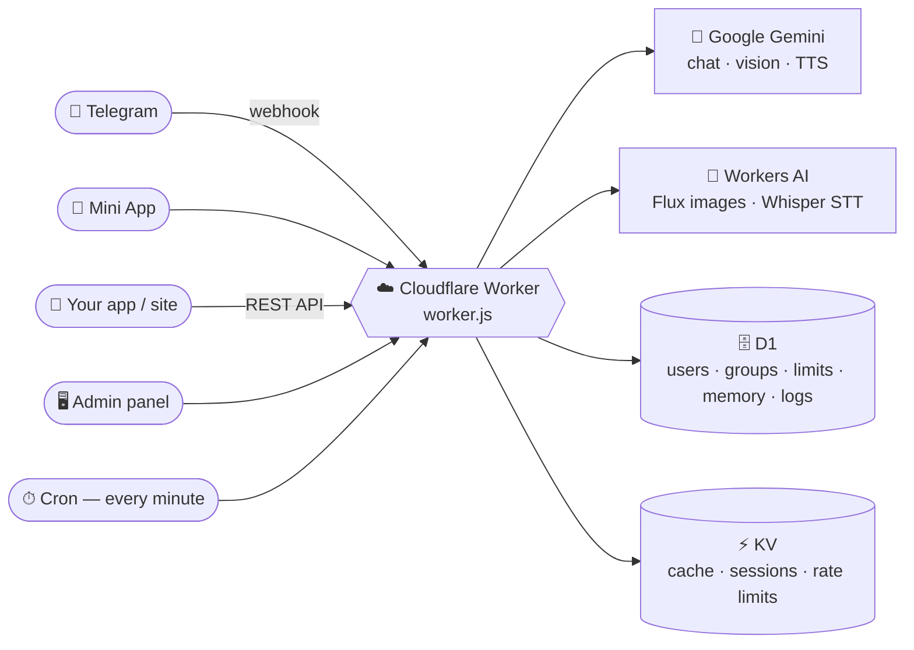

<div align="center">

# 🤖 Niki — your AI companion for Telegram

### A Persian-first, fully bilingual Gemini bot that runs **100% on Cloudflare Workers**

Chat · Photos · Voice · Image generation · Quizzes · Language & coding tutor · Mini App · Admin panel · Public API
**— one file, your own account, free tier friendly.**

<br>


<br>

[**🚀 One-click install**](https://wizard.nikibot.workers.dev/) &nbsp;·&nbsp;
[🧰 Manual install](#-manual-installation) &nbsp;·&nbsp;
[⌨️ Commands](#-bot-commands) &nbsp;·&nbsp;
[🖥 Admin panel](#-admin-panel) &nbsp;·&nbsp;
[📱 Mini App](#-telegram-mini-app) &nbsp;·&nbsp;
[🔌 API](#-external-api)

</div>


  💡 Tip: add screenshots here to make the page even more inviting, e.g.
  <p align="center">  </p>


---

## ⚡ Quick start (3 steps, ~1 minute)

| | Step | |
|:--:|---|---|
| **1** | Create a bot with [@BotFather](https://t.me/BotFather) and get a free key from [Google AI Studio](https://aistudio.google.com/apikey). | 🔑 |
| **2** | Open the **[installer](https://wizard.nikibot.workers.dev/)**, paste a Cloudflare token, press **Install**. | 🚀 |
| **3** | Open your new `/admin` panel, add the bot token + Gemini key, **set a password**, say hi to your bot. | 🎉 |

> No server. No Docker. No command line. Prefer the terminal? Use the [manual install](#-manual-installation) — same result.

---

## 📑 Table of contents

<details>
<summary><b>Click to expand</b></summary>

1. [Why Niki?](#-why-niki)
2. [Features](#-features)
3. [Requirements](#-requirements)
4. [Installation — the easy way](#-installation--the-easy-way-recommended)
5. [Manual installation](#-manual-installation)
6. [First-time setup](#-first-time-setup)
7. [How it works](#-how-it-works)
8. [Bot commands](#-bot-commands)
9. [Admin panel](#-admin-panel)
10. [Telegram Mini App](#-telegram-mini-app)
11. [External API](#-external-api)
12. [Configuration reference](#-configuration-reference)
13. [Privacy & security](#-privacy--security)
14. [Updating](#-updating)
15. [Troubleshooting](#-troubleshooting)
16. [FAQ](#-faq)
17. [Contributing & license](#-contributing--license)

</details>

---

## 💖 Why Niki?

Niki (نیکی) is a friendly assistant that lives in your Telegram chats. She answers in the language you write in (Persian first, English fully supported), understands photos and voice notes, draws pictures, speaks, teaches, and hosts quizzes — in private chats and in groups.

|  | Niki | A typical hosted bot |
|---|---|---|
| 🏠 **You own it** | Runs on **your** Cloudflare account | Runs on someone else's server |
| 💸 **Cost** | Free tier is enough for a small deployment | Subscription or ads |
| 🔐 **Privacy** | No chat viewer, no message search, logs never contain text | Often unknown |
| 🧩 **Everything included** | Bot + admin panel + Mini App + API in one file | Bot only |
| 🇮🇷 **Persian first** | Bilingual panel, texts and prompts | Usually English only |

---

## 🧩 Features

<table>
<tr>
<td width="50%" valign="top">

### 💬 Conversation
- **Gemini-powered** chat with automatic rotation across up to **10 API keys**
- **Five modes** (`/mode 1–5`): Friendly · Analytical · Custom prompt · English tutor · Programming
- **Short-term memory** per chat + **long-term memory** (archive and durable per-user facts)
- Optional **web search**, configurable per chat
- Understands **photos, voice notes and replies**
- Natural **emoji reactions**; group-aware (replies when called by name, or to everything with `/alwayson`)

</td>
<td width="50%" valign="top">

### 🎨 Media
- **Image generation** (Flux-1-schnell on Workers AI), up to 4 images per request
- **Voice replies** (text-to-speech) with selectable engine and voices
- **Speech-to-text** (Whisper on Workers AI) for voice notes
- **Voice-call mode** inside the Mini App

</td>
</tr>
<tr>
<td valign="top">

### 🎓 Learning & fun
- **Language tutor** and **programming tutor** with step-by-step sessions
- **Spaced-repetition** vocabulary cards
- **Shareable quizzes**, stats, leaderboards and certificates

</td>
<td valign="top">

### 👥 Groups & community
- Group activation with admin approval
- Roles: **User → Admin → Leader → Super admin**
- Moderation: mute, ban, purge, pin, lockdown
- **Invite links** with referral rewards

</td>
</tr>
<tr>
<td valign="top">

### 💳 Limits & monetisation
- Per-user and per-group **daily and total limits** (messages, images, voice)
- **Packages** (time-limited bundles) — sell with **Telegram Stars** or gift manually
- Daily caps, maintenance mode, welcome messages

</td>
<td valign="top">

### 🛠 Administration
- Bilingual **web admin panel** with a built-in guide
- **Resumable broadcast engine** (pause / resume / cancel)
- **Public REST API** (`/api/chat`, `/api/tts`, `/api/stt`) with per-key limits, expiry and CORS control
- Gemini key manager, logs, feature switches

</td>
</tr>
</table>

### 🔐 Privacy by design
**No chat viewer. No message search. No export.** Logs contain events, never message text. Users can wipe their own memory at any time.

---

## 📋 Requirements

| What | Notes |
|---|---|
| ☁️ **Cloudflare account** | The free plan is enough to start. |
| 🤖 **Telegram bot token** | Create one with [@BotFather](https://t.me/BotFather). |
| 🧬 **Gemini API key** | Free key from [aistudio.google.com/apikey](https://aistudio.google.com/apikey). Add more keys later to spread quota. |
| 🆔 **Your Telegram numeric ID** | Optional — makes you a *super admin*. Get it from any ID bot, e.g. `@userinfobot`. |
| 💻 **Node.js 18+ and `wrangler`** | Only for the [manual installation](#-manual-installation). |

---

## 🚀 Installation — the easy way (recommended)

The installer deploys Niki to **your own** Cloudflare account in about a minute — no command line needed.

> 🔗 **Installer:** **https://wizard.nikibot.workers.dev/**

### Step by step

1. **Open the installer** — <https://wizard.nikibot.workers.dev/> (English) or <https://wizard.nikibot.workers.dev/fa> (فارسی).
2. **Create a Cloudflare API token.** Click **Create a token** on the installer page; it pre-selects only the permissions needed:
   - Workers Scripts — **Edit**
   - Workers KV Storage — **Edit**
   - D1 — **Edit**
   - Account Settings — **Read**

   Press **Continue to summary → Create Token** and **copy the token**.
3. **Paste the token**, optionally choose a project name, and press **Install**.
4. The installer then creates, on your account:
   - a **D1 database** (`NIKI_DB`) and a **KV namespace** (`NIKI_KV`),
   - the **Workers AI** binding (`AI`),
   - the bot code, with the `workers.dev` URL enabled,
   - a **1-minute cron trigger** (broadcasts and scheduled jobs).
5. When it finishes you get two links:
   - 🌐 **Service URL** — `https://<name>.<your-subdomain>.workers.dev`
   - 🖥 **Admin panel** — `https://<name>.<your-subdomain>.workers.dev/admin` *(keep it private!)*
6. 🧹 **Delete the API token** in your Cloudflare dashboard — it is no longer needed.
7. Continue with [First-time setup](#-first-time-setup).

> 🔒 **Is my token safe?** The token is used only during the install request to talk to the Cloudflare API; it is not stored and not logged. If you would rather not give a token to any third-party page, use the [manual installation](#-manual-installation) — about 10 minutes, identical result.

> ⚠️ **The panel has no password on first launch.** Open it right after installing and set one (see below). Until you do, anyone who knows your Worker URL could open it.

### Updating with the installer
Run the installer again with the **same project name**. Your D1 data, KV data and secrets are kept; only the code is replaced.

---

## 🧰 Manual installation

Want full control, or deploying from the command line / CI? Follow these steps.

### 1. Get the code
```bash
git clone https://github.com/Shabakhti/niki-bot.git
cd niki-bot
npm install -g wrangler        # or use: npx wrangler ...
wrangler login
```

### 2. Create the storage
```bash
# D1 database
wrangler d1 create niki-db
# → copy the printed "database_id"

# KV namespace
wrangler kv namespace create NIKI_KV
# → copy the printed "id"
```

### 3. Create `wrangler.toml`
```toml
name = "niki-bot"
main = "worker.js"
compatibility_date = "2025-01-01"

# Workers AI (image generation, speech-to-text)
[ai]
binding = "AI"

[[d1_databases]]
binding = "NIKI_DB"
database_name = "niki-db"
database_id = "PASTE_D1_DATABASE_ID"

[[kv_namespaces]]
binding = "NIKI_KV"
id = "PASTE_KV_NAMESPACE_ID"

# Cron heartbeat — broadcasts, scheduled jobs (every minute)
[triggers]
crons = ["* * * * *"]

[vars]
# Comma-separated numeric Telegram IDs of the bot owner(s)
SUPER_ADMIN_IDS = "123456789"
```

> ℹ️ Binding names **must** be exactly `NIKI_DB`, `NIKI_KV` and `AI`.
> The database schema is created automatically on the first request — nothing to migrate by hand.

### 4. Add secrets
```bash
wrangler secret put TELEGRAM_BOT_TOKEN        # from @BotFather
wrangler secret put GEMINI_API_KEY_1          # your first Gemini key
# optional: more keys, GEMINI_API_KEY_2 … GEMINI_API_KEY_10
# optional but recommended: webhook protection
wrangler secret put TELEGRAM_WEBHOOK_SECRET   # any long random string
```
> You can also add the bot token and Gemini keys later from the admin panel instead of using secrets (see [First-time setup](#-first-time-setup)).

### 5. Deploy
```bash
wrangler deploy
```
Wrangler prints your Worker URL, e.g. `https://niki-bot.<your-subdomain>.workers.dev`.

### 6. Register the Telegram webhook

**Option A — from the panel (easiest):** open `https://<your-worker-url>/admin`, finish the setup card, and the panel registers the webhook for you.

**Option B — by hand:**
```bash
curl "https://api.telegram.org/bot<TELEGRAM_BOT_TOKEN>/setWebhook" \
  -d "url=https://<your-worker-url>/" \
  -d "secret_token=<TELEGRAM_WEBHOOK_SECRET>" \
  -d 'allowed_updates=["message","edited_message","callback_query","pre_checkout_query"]'
```
(Leave out `secret_token` if you did not set `TELEGRAM_WEBHOOK_SECRET`.)

### 7. Verify
```bash
curl "https://api.telegram.org/bot<TELEGRAM_BOT_TOKEN>/getWebhookInfo"
```
`url` should be your Worker URL and `last_error_message` should be empty. Now send `/start` to your bot. ✅

---

## 🧭 First-time setup

Open the **admin panel** at `https://<your-worker-url>/admin`.

1. **Finish the setup bar** at the top (it lists whatever is still missing):
   - 🤖 **Telegram bot token** and **bot username**
   - 🧬 **Gemini API key**
   - 🔐 **Panel password** — *set this immediately.*

   The setup card also registers the Telegram webhook for you.
2. **Add yourself as a super admin:** *Config → Super admins* → add your numeric Telegram ID (or use the `SUPER_ADMIN_IDS` variable).
3. **Set limits:** *Config → New-user limits / Group limits* — how many messages, images and voice notes users get.
4. *(Optional)* Customise the **default prompts**, bot name, welcome texts and voice engine.
5. Open the **📖 Guide** tab — a complete bilingual manual of every panel section, with your Mini App link ready to copy.
6. **Test it:** message your bot, then add it to a group and run `/init`.

### 👥 Activating a group
1. Add the bot to a group.
2. The group owner/creator sends **`/init`**. The request appears under **Overview → Requests** (super admins are also notified in private chat).
3. A super admin presses **Approve** — Niki now answers in that group.

Until a group is approved, the bot only responds to the activation flow.

### 🎭 Customising Niki's personality
Modes **1** and **2** ship with neutral, general-purpose default prompts. Make Niki yours without touching the code:

- **Whole bot:** *Admin → Config → Default prompts* — set a private and a group prompt for Mode 1 and Mode 2. Leave a field blank to use the built-in default.
- **One chat:** use the custom-prompt flow (`/mode 3`) or the Mini App's *Personalisation* section.
- **In the code:** edit the plain-text `PUBLIC_PROMPT_TEXT` object in section *§ 10 System prompt*.

---

## 🔍 How it works



- **Webhook** — Telegram POSTs updates to `/`. If `TELEGRAM_WEBHOOK_SECRET` is set, the `X-Telegram-Bot-Api-Secret-Token` header is verified, and updates are de-duplicated by `update_id`.
- **Routes**

  | Route | Purpose |
  |---|---|
  | `/` (POST) | Telegram webhook |
  | `/admin` (or `<prefix>/admin`) | Admin panel |
  | `/app` | Telegram Mini App |
  | `/api/chat` · `/api/tts` · `/api/stt` | Public REST API |

- **Key rotation** — Gemini keys are used in rotation, so one exhausted key never stops the bot.
- **Permissions** — `USER (0) < ADMIN (1) < LEADER (2) < SUPER (3)`. Super admins are defined by numeric ID only.
- **Limits** — daily and total pools for messages / images / voice, per user and per group; packages and invite rewards add to them.

---

## 📜 Bot commands

Commands work in private chats and groups unless noted. `<angle brackets>` = required, `[square]` = optional.
In a **private chat** you are the admin of your own conversation, so memory and persona commands are available to you.

<details open>
<summary><b>👤 Everyone</b></summary>

| Command | Description |
|---|---|
| `/start` | Start the bot / get the welcome message. |
| `/help` | Show help for the current chat type. |
| `/app` | Open the graphical **Mini App** (private chat). |
| `/lang fa\|en` | Language of the bot's fixed messages (help, limits, errors). |
| `/setname <name>` | Set the name the bot calls you. |
| `/myperm` | Show your permission level. |
| `/mylimit` | Show your remaining limits. |
| `/stats` | Your usage stats. |
| `/image <prompt>` | Generate one image. |
| `/image <n> <prompt>` | Generate `n` images (up to 4). |
| `/invite` · `/mylink` | Get your personal invite link (earn rewards). |
| `/myfriends` · `/friends` | List the friends you invited. |
| `/packages` | View / buy available packages. |

</details>

<details>
<summary><b>🧠 Persona & memory</b> (private chat, or group admins)</summary>

| Command | Description |
|---|---|
| `/mode 1\|2\|3\|4\|5` | Switch persona: **1** Friendly · **2** Analytical · **3** Custom prompt · **4** English tutor · **5** Programming. `/mode` alone opens a picker. |
| `/reset` | Clear this chat's short-term memory. |
| `/memstats` | Long-term memory statistics. |
| `/memclear` | Clear long-term memory. |
| `/alwayson` | Toggle "reply to every message". |
| `/histclear` | Clear this chat's history and archive. |
| `/logclear` | Clear this chat's long-term log. |
| `/logremove <n>` | Remove entry number `n` from the long-term log. |

</details>

<details>
<summary><b>🛡 Group admins</b></summary>

| Command | Description |
|---|---|
| `/init` | *(Group creator)* Request group activation. |
| `/silent` | Mute / unmute Niki in this group. |
| `/lockdown` | Toggle lockdown mode. |
| `/say <text>` | Make the bot say something (deletes your command). |
| `/delete <n>` | Remove the last `n` messages from the bot's memory of this chat. |
| `/purge <n>` | Purge the last `n` messages (1–100). |
| `/clear` | Bulk-delete recent messages from the Telegram chat **and** wipe this chat's memory and archive. |
| `/pin` · `/unpin` · `/unpinall` | Pin / unpin messages. |
| `/mute @user` · `/unmute @user` | Mute / unmute a member. |
| `/ban @user` · `/unban @user` | Ban / unban a member. |
| `/log [admin\|error\|warn\|info]` | Recent system log of this chat (events only, no message text). |
| `/admins` | Show leader and admins. |

</details>

<details>
<summary><b>👑 Group leader</b></summary>

| Command | Description |
|---|---|
| `/setleader @user` | Set the group leader. |
| `/promote @user` | Promote a member to group admin. |
| `/demote @user` | Remove group admin rights. |

> Super admins cannot be muted, banned or demoted by group staff.

</details>

<details>
<summary><b>🔧 Super admins only</b></summary>

| Command | Description |
|---|---|
| `/debug` | Runtime / state snapshot. |
| `/testai` | Test all Gemini keys. |
| `/testimage` | Test the image pipeline. |

</details>

### 💡 Talking to Niki in groups
- Without `/alwayson`, include **Niki** (or **نیکی**) in your message — or reply to one of her messages.
- With `/alwayson`, she answers everything.
- She can react with emoji, and group admins can ask her in plain language to pin, unpin or delete messages.

---

## 🖥 Admin panel

Open `https://<your-worker-url>/admin`. Use the **🌐 FA/EN** button to switch language. The built-in **📖 Guide** tab explains everything below step by step.

| Tab | What you do there |
|---|---|
| 📊 **Overview** | Live stats (users, groups, today's messages / images / voice) and **pending group requests** to approve or reject. |
| 💬 **Groups** | Search active groups, edit limits, send messages, open per-group settings. |
| 👤 **Users** | Search users; view profile, edit limits, **reward** quota, send a direct message. |
| 📢 **Broadcast** | Send text / image / file / voice to everyone, users only, groups only, or one chat. Queued as a resumable **mission** with live status, *Run now*, pause, resume, cancel and history. |
| 🔑 **API Keys** | Create keys for the [external API](#-external-api), set limits / expiry / CORS, test in a console, see users per key. Includes a full API guide. |
| 🧬 **Gemini keys** | Add / import / export / disable Gemini keys. |
| 📦 **Packages** | Create package templates, activate them on any chat, see active packages and **Telegram Stars** purchase history. |
| ⚙️ **Config** | Default limits, prompts (group / private / API), start & invite rewards, voice engine, default AI model, bot name & username, bot token override, **super admins**, **panel password**, clear-history tools. |
| 🧠 **Features** | Switch capabilities on/off for the Mini App, private chats and groups; daily caps; welcome texts; **maintenance mode**; per-chat overrides. |
| 📋 **Log** | System events by level (admin / warn / error / info). |
| 📖 **Guide** | Complete bilingual manual, quick start, command cheat-sheet and the Mini App link. |

**Panel security:** once you set a password the panel requires login (6-hour session, secure cookie). The optional `ADMIN_PANEL_PASSWORD` Worker secret works as an emergency recovery password if you ever forget yours.

---

## 📱 Telegram Mini App

A ChatGPT-style graphical app that opens **inside Telegram** at `/app`.

**Open it**
- Send `/app` to the bot in a private chat and tap the **App** button, or
- share the link `https://t.me/<your_bot_username>?start=app` (shown in *Admin → 📖 Guide → Mini App*).

**Optional BotFather setup** (adds a permanent menu button):
`@BotFather → /mybots → your bot → Bot Settings → Menu Button → Configure menu button`, then use `https://<your-worker-url>/app` as the URL.
For a direct link like `t.me/<bot>/<app>`, use `/newapp` with the same URL.

**Sections** (each can be switched on/off in *Admin → Features → Mini App*)

| | Section |
|---|---|
| 💬 | Regular chat (synced with Telegram) |
| 🧑‍💻 | Programmer chat |
| 🎓 | Language learning · Programming learning |
| 🧠 | Quizzes (shareable) |
| 🗂️ | Vocabulary cards (spaced repetition) |
| 📊 | Stats & leaderboards |
| 🎙️ | Voice call mode |
| 🎭 | Personalisation (name & prompt) |
| 🏅 | Learning certificates |
| 🖼️ | Image generation |
| ✏️ | Rename & delete chats |

> The Mini App only works inside Telegram — requests are authenticated with Telegram's signed `initData`, verified on the server. Telegram only allows the `web_app` button in **private chats**; in groups, share the link instead.

---

## 🔌 External API

Use Niki's brain from your own site, app or bot — no Telegram required. Create a key in **Admin → 🔑 API Keys** (the key is shown only once).

```bash
curl -X POST "https://<your-worker-url>/api/chat" \
  -H "X-API-Key: YOUR_KEY" \
  -H "Content-Type: application/json" \
  -d '{"userId":"42","message":"Hello!"}'
```

```json
{"ok":true,"reply":"Hi! How can I help?","usage":{"msgUsed":3,"msgLimit":500,"imgUsed":0,"imgLimit":20}}
```

| Endpoint | Purpose | Body |
|---|---|---|
| `POST /api/chat` | Chat: text / image / voice in → text (optionally image / voice) out | `{"userId","message", …}` |
| `POST /api/tts` | Text → speech | `{"text":"…","lang":"auto"}` |
| `POST /api/stt` | Speech → text | `{"audioBase64":"…"}` |

**Highlights**
- **Auth:** `X-API-Key: KEY` (also `Authorization: Bearer KEY` or `?api_key=KEY`).
- **Per-user memory & limits:** send a stable `userId` and every end-user automatically gets their own memory, system prompt and quota.
- **Optional fields:** `imageBase64`/`imageMime`, `audioBase64`/`audioMime`, `transcribeAudio`, `voiceReply`, `systemPrompt`, `setSystemPrompt`, `memory`, `setLimits`/`addLimits`.
- **Whole-key report:** `{"userId":"admin"}` returns total usage, user count and expiry at no cost.
- **Errors:** `401` bad key · `403` disabled/expired · `400` bad body · `413` too large · `429` limit reached · `502/500` model problem (quota is refunded).

The complete reference (all fields, examples in several languages) is in the panel under **API Keys → 📖 API guide**.

> 🔒 Call the API from **your server**. A key embedded in a public web page or mobile app can be copied by anyone.

---

## 🔧 Configuration reference

### Bindings (required)

| Name | Type | Purpose |
|---|---|---|
| `NIKI_DB` | D1 database | Users, groups, limits, memory, packages, logs |
| `NIKI_KV` | KV namespace | Caches, sessions, rate limits, deduplication |
| `AI` | Workers AI | Image generation, speech-to-text |

### Secrets & variables

| Name | Required | Description |
|---|:--:|---|
| `TELEGRAM_BOT_TOKEN` | ✅* | Bot token. *May instead be entered in the admin panel (the panel value takes priority).* |
| `GEMINI_API_KEY_1` … `_10` | ✅* | Gemini keys. *May instead be added in the panel's 🧬 Gemini keys tab.* |
| `SUPER_ADMIN_IDS` | ➖ | Comma-separated numeric Telegram IDs of super admins. IDs can also be added in *Config → Super admins*. |
| `TELEGRAM_WEBHOOK_SECRET` | ➖ | Random string; enables webhook header verification (**recommended**). |
| `ADMIN_PANEL_PASSWORD` | ➖ | Emergency recovery password for the admin panel. |

### Cron
A `* * * * *` trigger is recommended. It drives broadcast missions and scheduled maintenance. Broadcasts also advance opportunistically on incoming traffic, but the cron keeps them on time.

### Runtime-configurable (admin panel)
Default and per-chat limits · prompts per chat type · default AI model · voice engine and voices · bot name · welcome texts · feature switches per chat type · daily caps · maintenance mode · invite and start rewards · packages and prices.

---

## 🔐 Privacy & security

**Message privacy**
- The admin panel and bot commands have **no way to read or search users' conversations** — no conversation viewer, no archive search, no export.
- System logs record events (for example "group approved"), never message text.
- Users can erase their own context with `/reset`, `/memclear` and `/histclear`; admins can wipe stored history from *Config → Clear history*.
- Conversation context is still stored in your D1 database because the bot needs it to remember. Anyone with access to your Cloudflare account can technically read that database — **you are the data controller**, so tell your users what you store.
- Messages are sent to Google Gemini to generate replies, so Google's terms apply to that content.

**Operational security checklist**
- [ ] Set an **admin panel password** right after the first launch.
- [ ] Set `TELEGRAM_WEBHOOK_SECRET` so only Telegram can call the webhook.
- [ ] Identify super admins by **numeric ID only** (usernames can change or be spoofed).
- [ ] Keep tokens and API keys in Cloudflare **Secrets** — never commit them.
- [ ] Use one API key per app, with limits and an expiry; delete a key the moment it leaks.
- [ ] Delete the installer's Cloudflare API token once installation is done.

The Mini App verifies Telegram's signed `initData` on the server; client claims are never trusted.

---

## 🔄 Updating

- **Installer:** run it again with the same project name.
- **Wrangler:** `git pull && wrangler deploy` — bindings, data and secrets are preserved.
- Database tables are created automatically on first use after deploy.

---

## 🩺 Troubleshooting

| Problem | Fix |
|---|---|
| Bot doesn't answer at all | Check `getWebhookInfo` (`url`, `last_error_message`). Re-run the panel's setup card, or call `setWebhook` again. Make sure the bot token is valid. |
| `401/403` on the webhook | The secret in Telegram's `setWebhook` and `TELEGRAM_WEBHOOK_SECRET` must match — or remove the secret from the Worker. |
| Bot silent in a group | The group isn't approved yet (*Overview → Requests*), or it is in `/silent` mode. Mention **Niki** or use `/alwayson`. |
| "AI request failed" / no model keys | A Gemini key is exhausted or invalid. Add keys in *🧬 Gemini keys*. |
| Image generation fails | Check that the `AI` binding exists and Workers AI is available on your account. |
| Mini App link is empty | Enter the bot username in *Config → Bot username*. |
| Mini App is blank | Make sure the Mini App switch is on (*Features → Mini App*) and open it from Telegram, not a normal browser. |
| Broadcast is stuck | The mission may be paused — use *Resume* or *Run now*. Check that the cron trigger exists. |
| Forgot the panel password | Create the `ADMIN_PANEL_PASSWORD` secret, sign in with it, then set a new password in *Config*. |
| Installer says the token lacks permission | Create the token with the installer's **Create a token** link so the right permissions are pre-selected. |

---

## ❓ FAQ

<details>
<summary><b>Does it cost anything?</b></summary>
A small deployment fits Cloudflare's free tier, and Gemini offers a free tier too. Heavy usage may need paid plans on either side.
</details>

<details>
<summary><b>Can I use it only in English?</b></summary>
Yes — set the language per chat with <code>/lang en</code>; the AI answers in whatever language the user writes.
</details>

<details>
<summary><b>Can I change Niki's personality?</b></summary>
Yes. Set your own prompts in <i>Admin → Config → Default prompts</i>, per chat with <code>/mode 3</code>, or edit <code>PUBLIC_PROMPT_TEXT</code> in the code. See <a href="#-customising-nikis-personality">Customising Niki's personality</a>.
</details>

<details>
<summary><b>Can I run several bots?</b></summary>
Yes. Deploy once per bot (each gets its own D1/KV), e.g. by running the installer with different project names.
</details>

<details>
<summary><b>Can I sell access?</b></summary>
Yes — create <b>Packages</b> and enable Telegram Stars purchases, or gift quota to users from the panel.
</details>

<details>
<summary><b>Is the code open?</b></summary>
Yes. The bot is a single, readable JavaScript module; sections are marked <code>§ N</code> with a table of contents at the top of the file.
</details>

---

## 🤝 Contributing & license

Issues and pull requests are welcome — please open an issue first for larger changes. When submitting code, keep the single-file layout (section markers `§ N`) and **never add features that expose users' message content**.

**License:** [Apache License 2.0](LICENSE) — free to use, modify and distribute (including commercially), as long as you keep the license and copyright notice and state significant changes. It also includes an express patent grant. Contributions you submit are licensed under the same terms.

---

<div align="center">

**If Niki is useful to you, a ⭐ on the repo means a lot!**

Made with ❤️ for the Persian-speaking Telegram community by [**Shabakhti**](https://github.com/Shabakhti) · **v0.5.0-beta**<br>Licensed under the [Apache License 2.0](LICENSE)

</div>
